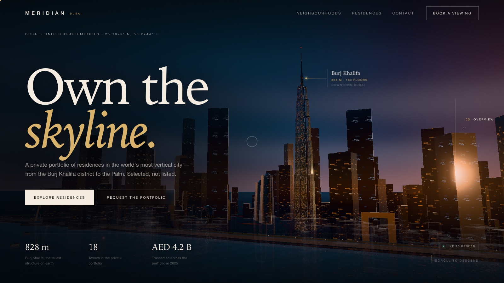

# Meridian — Dubai Residences

A single-page real-estate landing page with a real-time 3D hero of the Dubai skyline, centred on the Burj Khalifa.



## Run it

```bash
cd dubai-skyline
python3 -m http.server 4173
```

Open <http://127.0.0.1:4173/>. No build step or network connection is required: Three.js is vendored locally and every 3D asset is generated in the browser.

## What is included

- **3D hero** — procedural Burj Khalifa and Dubai skyline, water reflections, dusk sky, bloom, pointer parallax and a scroll-driven camera that moves through Downtown, Dubai Marina and Palm Jumeirah.
- **Anchored landmark callout** — the "Burj Khalifa · 828 m" label is projected from the live camera each frame.
- **Editorial layout** — neighbourhood chapters, four residence cards, private-viewing form, chapter rail and mobile navigation.
- **Resilience** — static poster fallback when WebGL is unavailable, no-JavaScript fallback, reduced-motion mode and adaptive quality if frame rate drops.
- **Responsive** — tested at 1600×900, 1280×800, 1024×768, 768×1024 and 390×844.

## Customise

| What | Where |
| --- | --- |
| Brand name, copy, prices, contact details | `index.html` |
| Colours, type scale, spacing, breakpoints | `assets/css/style.css` |
| Camera choreography, pointer response, landmark label | `assets/js/main.js` |
| Skyline geometry, landmarks, Burj Khalifa | `assets/js/city.js` |
| Sky, lighting, water shader | `assets/js/environment.js` |
| Facade textures and materials | `assets/js/materials.js` |
| Fallback / social preview images | `assets/hero-poster.jpg`, `assets/preview-desktop.jpg` |

The company, listings and prices are illustrative placeholders. Replace them with the real portfolio before publishing. The contact form is a front-end demo and does not send email yet; connect it to your CRM or form endpoint.

## Verification scripts

`shots/capture.mjs` records the hero and scroll chapters with Playwright; `shots/mobile.mjs` captures the mobile hero. Both expect the local server above.
